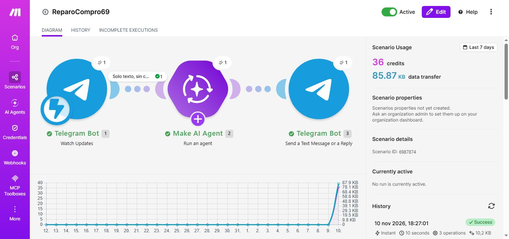
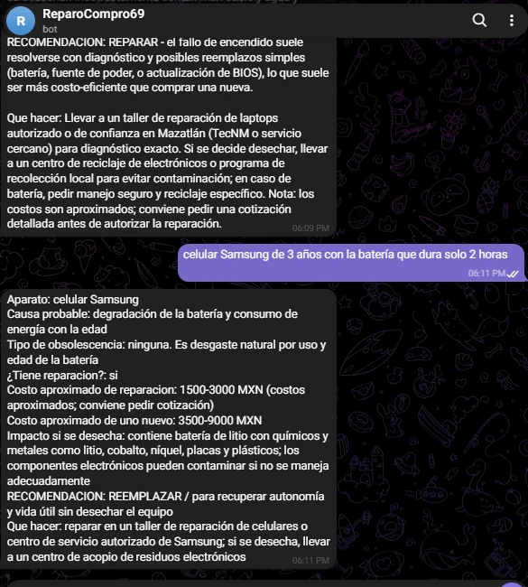
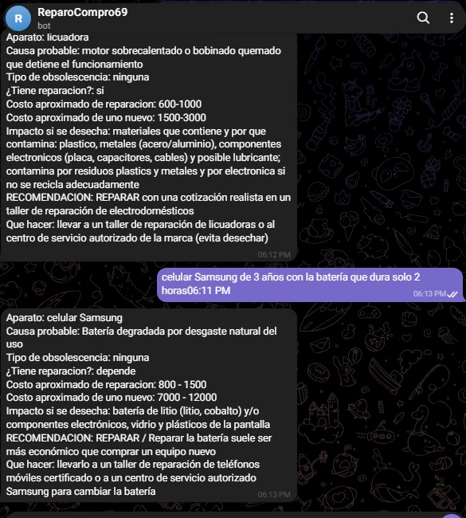
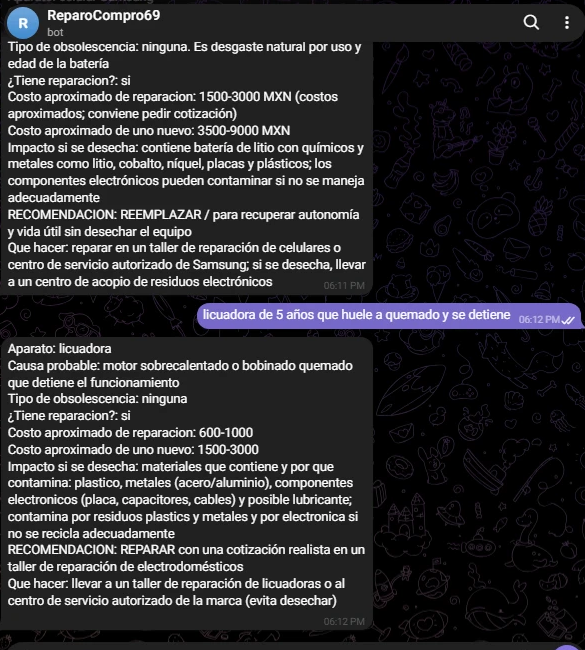
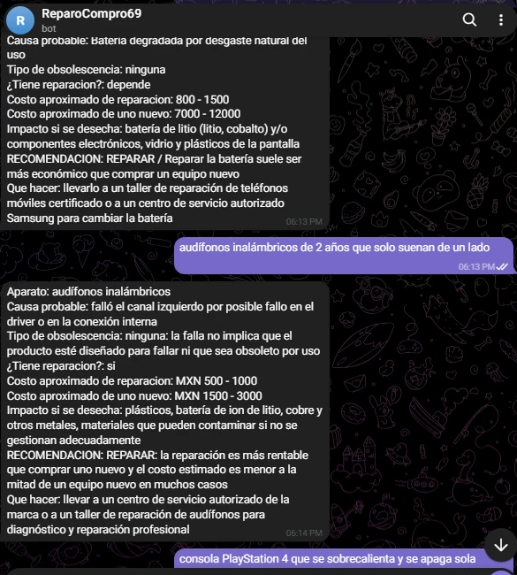
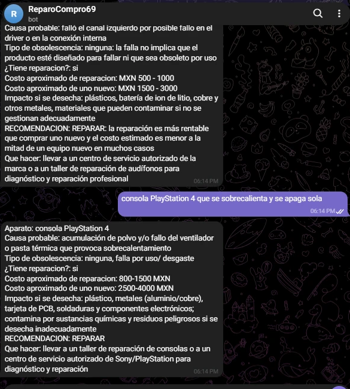
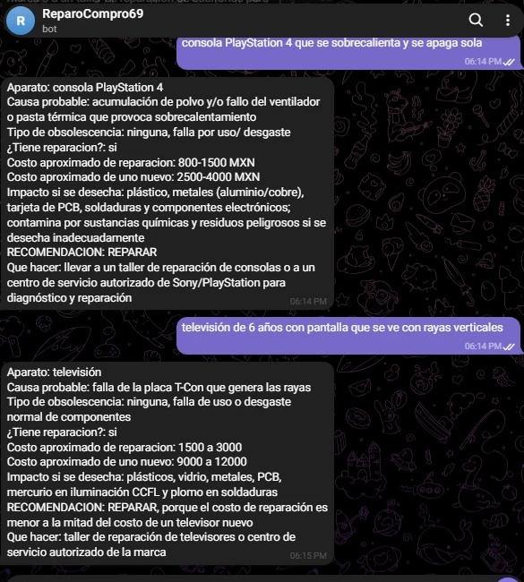
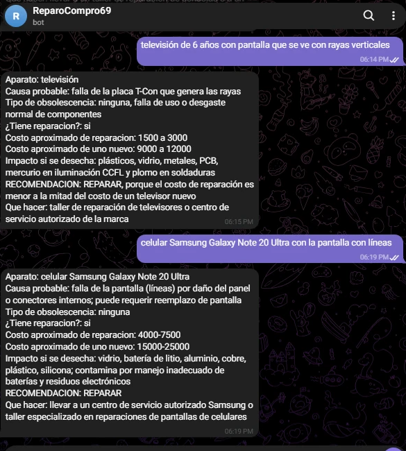
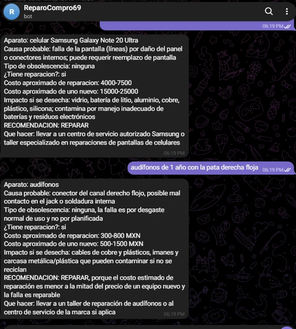
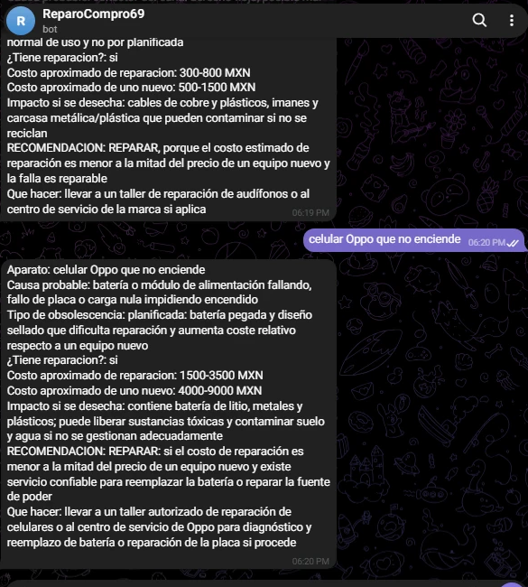

# Práctica 4.4 – Bot "¿Reparo o compro?"

| Dato | Valor |
|---|---|
| Estudiante | Roberto Carlos Robles Campos |
| Escuela | Tecnológico Nacional de México – Instituto Tecnológico de Mazatlán |
| Materia | Desarrollo Sustentable (ACD-0908) |
| Práctica | 4.4-P4 Bot "¿Reparo o compro?" |

**Escenario de Make:** [`codigo/blueprint.json`](codigo/blueprint.json) · **Resultados (PDF):** [`resultados/Resultados.pdf`](resultados/Resultados.pdf)

## 1. Objetivo
Distinguir la obsolescencia planificada de la percibida, valorar la reparación como alternativa de consumo y verificar con información local (un taller de Mazatlán) las recomendaciones de una IA.

## 2. Investigación previa

**Obsolescencia planificada y percibida.** *(Fuente secundaria: Wikipedia, porque no pude abrir una fuente institucional.)* La obsolescencia **planificada** es planear o diseñar un producto con una vida útil artificialmente limitada o un diseño intencionalmente frágil, para que quede obsoleto después de un periodo predeterminado [1]. La **percibida** (también llamada psicológica o "de deseabilidad") es el intento de los mercadólogos de desgastar un producto en la mente de su dueño, aunque siga funcionando: el producto se vuelve obsoleto porque "pasó de moda". Vance Packard la distinguió de la "obsolescencia de función" en su libro *The Waste Makers* (1960) [1].

**Tres ejemplos reales de obsolescencia**

| # | Ejemplo | Tipo | Qué pasó |
|---|---|---|---|
| 1 | **General Motors y el cambio de modelo anual** | Percibida | En 1924 el mercado automotriz de EE. UU. se saturó, y el ejecutivo de General Motors Alfred P. Sloan Jr. propuso cambiar el diseño de los autos cada año por "año modelo" para que los dueños sintieran viejo el anterior [1]. |
| 2 | **Apple y Samsung, multa en Italia (2018)** | Planificada (por software) | El 24 de octubre de 2018 la autoridad de competencia de Italia multó a Apple con 10 millones de euros y a Samsung con 5 millones por prácticas comerciales desleales: según la autoridad, indujeron a los consumidores a instalar actualizaciones que sus aparatos no soportaban bien (Android Marshmallow en el Galaxy Note 4 y iOS 10 en el iPhone 6), sin avisarles que podían volverlos más lentos [2]. |
| 3 | **Cártel Phoebus (focos)** | Planificada | Se cita como el caso clásico: según el resumen de Wikipedia que leí, el cártel buscó fijar la vida útil de los focos en 1,000 horas, frente a las 2,500 de antes [1]. *No pude verificarlo en el texto completo ni confirmar el año.* |

**Derecho a reparar.** Es el derecho de los consumidores a que sus aparatos puedan repararse, con acceso a piezas, herramientas e información a un precio razonable, y no solo reemplazarse. Países y regiones donde ya es ley:
- **Unión Europea:** la Directiva (UE) 2024/1799, del 13 de junio de 2024, "sobre normas comunes para promover la reparación de bienes" (publicada en el Diario Oficial de la UE el 10 de julio de 2024). Obliga al fabricante a reparar, a petición del consumidor y aunque ya no haya garantía del vendedor, los bienes que tengan requisitos de reparabilidad de la UE, a un precio razonable o gratis [3]. *Según resúmenes que no pude confirmar en el texto, los estados miembros debían aplicarla a más tardar el 31 de julio de 2026 y cubre aparatos como lavadoras, refrigeradores, pantallas, celulares y tabletas.*
- **Estados Unidos (leyes estatales):** **Nueva York** fue el primer estado (en vigor en diciembre de 2023); **Minnesota** (julio de 2024); **California**, con la ley SB 244 firmada en octubre de 2023 y en vigor desde el 1 de julio de 2024, que exige dar documentación, piezas y herramientas "en términos justos y razonables"; **Oregón** (aprobada en 2024) y **Colorado** (2024) [4][5].
- **México:** en mi búsqueda no encontré una ley federal de derecho a reparar ni una iniciativa. *Esto no prueba que no existan: no revisé la Gaceta Parlamentaria.*

## 3. Cómo funciona

Flujo: **Telegram (Watch Updates) → Make AI Agent → Telegram (respuesta)**.

| # | Módulo | Configuración |
|---|---|---|
| 1 | Telegram Bot → Watch Updates | Recibe lo que se escribe al bot `ReparoCompro69` |
| — | Filtro "Solo texto, sin comandos" | `Message → Text` existe **y** no empieza con `/`, así no se gastan créditos con stickers, fotos o comandos |
| 2 | Make AI Agent | Conexión *Make's AI Provider*. Input: `Aparato y falla: {{1.message.text}}`. Instrucciones: asesor de reparación de aparatos con un formato fijo (aparato, causa probable, tipo de obsolescencia, ¿tiene reparación?, costo de reparar, costo de uno nuevo, impacto si se desecha, recomendación y qué hacer) |
| 3 | Telegram Bot → Send a Text Message or a Reply | Chat ID = el chat del mensaje recibido; texto = respuesta del agente |

El token del bot no está en ningún archivo del repo.

**Ajustes que le hice a las instrucciones de la práctica.** Con la primera prueba aparecieron fallos y agregué un bloque de **Reglas** a las instrucciones (están completas en [`codigo/blueprint.json`](codigo/blueprint.json)):
- Elegir **una** opción de obsolescencia (planificada, percibida o ninguna) y no escribir "depende".
- Que la recomendación sea coherente con los costos: **REPARAR** si reparar cuesta menos de la mitad de uno nuevo; **REEMPLAZAR** solo si no tiene reparación o cuesta más de la mitad.
- Que "Qué hacer" coincida con la opción elegida y recomiende tipos de negocio, no instituciones (la IA había recomendado al TecNM como taller).
- En "Impacto" mencionar solo materiales que el aparato realmente contenga.

**Consumo:** cada consulta con respuesta gastó entre **3.33 y 3.69 créditos** (≈ 3.5), con 3 operaciones y entre 6 y 15 segundos. Un mensaje que no pasa el filtro gasta solo 1 crédito.

## 4. Pruebas del bot

### 4.1 Los 6 casos
Todas las respuestas son del 10 de noviembre de 2026, entre las 6:08 y las 6:15 de la tarde (hora de Mazatlán).

| # | Aparato y falla | Obsolescencia (IA) | ¿Reparación? | Reparar (MXN) | Uno nuevo (MXN) | Recomendación |
|---|---|---|---|---|---|---|
| 1 | Laptop que no prende y solo enciende tras esperar unos 5 minutos *(antes del ajuste)* | depende | depende | 1,500–6,000 | 5,000–25,000 | REPARAR |
| 2 | Celular Samsung de 3 años con la batería que dura 2 horas *(respuesta tras el ajuste)* | ninguna | depende | 800–1,500 | 7,000–12,000 | REPARAR |
| 3 | Licuadora de 5 años que huele a quemado y se detiene | ninguna | sí | 600–1,000 | 1,500–3,000 | REPARAR |
| 4 | Audífonos inalámbricos de 2 años que solo suenan de un lado | ninguna | sí | 500–1,000 | 1,500–3,000 | REPARAR |
| 5 | Consola PlayStation 4 que se sobrecalienta y se apaga sola | ninguna | sí | 800–1,500 | 2,500–4,000 | REPARAR |
| 6 | Televisión de 6 años con rayas verticales | ninguna | sí | 1,500–3,000 | 9,000–12,000 | REPARAR |

### 4.2 Errores que se vieron en las respuestas
- **Primera respuesta de la laptop (antes del ajuste):** puso "depende" en obsolescencia, recomendó el **TecNM** como lugar de reparación y dijo que las placas llevan "mercurio/arsénico/pb". El TecNM no es un taller, y el mercurio y el arsénico no son típicos de una laptop moderna; no lo verifiqué con fuente. Por eso agregué las reglas.
- **Primera respuesta del Samsung (antes del ajuste):** recomendó **REEMPLAZAR**, pero su razón era "recuperar autonomía y vida útil sin desechar el equipo" y en "qué hacer" decía "reparar en un taller", y reparar (1,500–3,000) costaba menos de la mitad de uno nuevo (3,500–9,000). Se contradecía.
- **La IA da rangos distintos para el mismo caso:** el celular Samsung con batería salió en 1,500–3,000 (reparar) y 3,500–9,000 (nuevo) la primera vez, y en 800–1,500 y 7,000–12,000 después del ajuste.
- **Televisión:** dijo que contiene "mercurio en iluminación CCFL", algo propio de pantallas con luz fluorescente; puede no aplicar a un televisor de 6 años. No lo verifiqué.
- **Formato:** en varios casos "Tipo de obsolescencia" trae solo "ninguna" sin la línea de explicación que pide el formato, y los costos aparecen con estilos distintos ("MXN 500-1000", "800-1500 MXN" y "1500 a 3000"). En la consola, la recomendación salió sin razón.
- **Sesgo hacia REPARAR:** en las 10 respuestas **solo una** recomendó reemplazar (la del Samsung, que se contradecía); las demás, incluida la de un celular que el taller declaró sin arreglo (sección 5), dijeron REPARAR.

## 5. Verificación con un taller de Mazatlán

Consulté 3 casos en **Exvehl reparaciones**, un taller de Mazatlán. Después le mandé al bot el mismo síntoma, sin darle el diagnóstico del taller:

| Aparato y falla | Respuesta de la IA | Costo de reparar según la IA (nuevo) | Cotización del taller | Fecha aproximada | Tipo de obsolescencia (IA) | ¿Coincide? |
|---|---|---|---|---|---|---|
| Samsung Galaxy Note 20 Ultra con la pantalla con líneas | REPARAR | $4,000–7,500 ($15,000–25,000) | Tiene reparación: cambio de pantalla, **$6,300** | hace unos 6 meses (mayo de 2026) | ninguna | **Sí.** El precio real cae dentro del rango. |
| Audífonos de 1 año con la pata derecha floja | REPARAR | $300–800 ($500–1,500) | Tiene reparación: cambio de la pieza, **$350** | hace 1 mes (octubre de 2026) | ninguna | **Sí.** El precio real cae dentro del rango, cerca del mínimo. |
| Celular Oppo que no enciende | REPARAR *(condicionada: "si el costo de reparación es menor a la mitad…")* | $1,500–3,500 ($4,000–9,000) | **No tiene arreglo:** "se murió la lógica", conviene comprar otro | hace 1 año y 2 meses (septiembre de 2025) | planificada | **No.** La IA dijo reparar y el taller dijo reemplazar. |

**Resultado:** la IA coincidió con el taller en **2 de 3 casos (67 %)**.

**Limitaciones de la comparación:**
- **Un solo taller.** Las tres cotizaciones son del mismo local, así que es una referencia y no un promedio del mercado.
- **Fechas distintas.** Las cotizaciones son de hace 1 mes, 6 meses y 14 meses; los precios pudieron cambiar. La más reciente y más comparable con lo que la IA estima hoy es la de los audífonos.
- **La IA no vio el aparato:** solo recibió una descripción de una línea.

## Video de la prueba en vivo

[Ver la prueba en YouTube](https://youtu.be/ovaF8jgN9cM)

El enlace también está en [`video/enlace.txt`](video/enlace.txt).

## 6. Preguntas de reflexión

**1. ¿Cuántos de los 6 aparatos tenían reparación? ¿Cuántos se habrían desechado sin necesidad?**
Según la IA, los 6 aparatos de la tabla 4.1 tenían reparación y recomendó repararlos todos, pero eso es solo una estimación: ninguno de esos 6 lo revisó un taller. Los únicos casos confirmados por un taller son los 3 de la sección 5: **2 de 3 tenían reparación** (la pantalla del Samsung Note 20 Ultra, por $6,300, y los audífonos, por $350) y 1 no (el Oppo, con la placa lógica dañada). Los dos primeros se habrían desechado sin necesidad si se hubieran reemplazado: el Samsung se repara por $6,300 contra los $15,000–25,000 que, según la IA, cuesta uno nuevo, y los audífonos por $350 contra $500–1,500. En el Oppo, en cambio, comprar otro era lo razonable. Es decir, en esta muestra pequeña, 2 de cada 3 aparatos se habrían tirado sin necesidad, aunque con 3 casos de un solo taller esa proporción no se puede generalizar.

**2. ¿Qué tan cercanas fueron las estimaciones de la IA a las cotizaciones reales? ¿Por qué creen que difieren?**
En los dos casos con una falla clara (pantalla con líneas y pieza floja) el precio real cayó dentro del rango de la IA: $6,300 dentro de $4,000–7,500, y $350 dentro de $300–800, cerca del mínimo. Pero los rangos son amplios y poco estables: para el mismo celular con batería la IA dio dos rangos distintos en dos consultas. Y falló en el Oppo: dijo reparar, mientras que el taller dijo que no había arreglo porque se dañó la placa lógica, algo que no se puede saber sin abrir el aparato. Las diferencias se explican porque la IA no tiene precios reales de Mazatlán, no ve el aparato ni puede diagnosticarlo, y estima con rangos amplios; además las cotizaciones tienen fechas distintas (de hace 1 a 14 meses) y vienen de un solo taller.

**3. ¿Qué casos fueron de obsolescencia planificada y cuáles de percibida?**
Según la IA, todos fueron "ninguna" salvo el Oppo, que marcó como planificada por "batería pegada y diseño sellado". Mi análisis: ningún caso es de obsolescencia **percibida**, porque todos los aparatos tenían una falla real y no eran aparatos que funcionaran pero se sintieran viejos. El Oppo es el mejor candidato a **planificada**: un celular que muere por la placa lógica y que el taller no puede reparar, aunque no tengo evidencia de que se haya diseñado para fallar, y la explicación de la IA (batería pegada) es una suposición, porque el taller dijo que lo que falló fue la lógica. Los audífonos de 1 año con la pata floja y los audífonos inalámbricos con batería sellada también podrían ser planificada, si el diseño dificulta repararlos; pero el taller los repara por $350, así que en ese caso no hay bloqueo. Los ejemplos de la investigación sí son claros: General Motors (percibida) y Apple y Samsung en Italia (planificada, por software).

**4. ¿Qué impide que más personas reparen sus aparatos (costo, falta de talleres, diseño del producto)?**
Los tres factores aparecen en los resultados. El **costo**: reparar la pantalla del Samsung cuesta $6,300, una cantidad que muchas personas prefieren usar en un aparato nuevo, aunque uno nuevo cueste mucho más. La **falta de información y de diagnóstico**: la IA no pudo saber que el Oppo no tenía arreglo, y sin cotización nadie sabe si vale la pena; por eso las respuestas siempre piden una. El **diseño**: baterías selladas y placas lógicas que no se pueden reparar, como en el Oppo. Por eso se creó el derecho a reparar: en la Unión Europea, la directiva obliga al fabricante a reparar a un precio razonable [3], y en estados de EE. UU. como California obligan a dar piezas, herramientas y documentación [4]. En México no encontré una ley equivalente.

**5. ¿Qué alternativas proponen para cambiar las pautas de consumo de su familia?**
*(Borrador, para que lo revise y lo cambie el estudiante.)* Antes de reemplazar un aparato, pedir una cotización en un taller, como hicimos con Exvehl: dos de los tres casos se podían reparar por mucho menos que uno nuevo. Cuando algo falla, buscar primero si es una pieza (batería, pantalla, conector) y no cambiar todo. Al comprar, preferir aparatos con piezas disponibles y baterías cambiables, y preguntar por la garantía y el servicio técnico. Si un aparato ya no tiene arreglo, no tirarlo a la basura: llevarlo a un centro de acopio de residuos electrónicos o donarlo. Y esperar a que el aparato falle y no cambiarlo cada vez que sale un modelo nuevo, para no caer en la obsolescencia percibida.

## 7. Fuentes

Leídas el 10 de noviembre de 2026.

1. Wikipedia, *Planned obsolescence* (lectura parcial): <https://en.wikipedia.org/wiki/Planned_obsolescence>
2. Telecompaper, *Italy fines Apple and Samsung EUR 15 mln over 'planned obsolescence'*, 24/10/2018: <https://www.telecompaper.com/nieuws/italy-fines-apple-and-samsung-eur-15-mln-over-planned-obsolescence--1266292>
3. Directiva (UE) 2024/1799 del Parlamento Europeo y del Consejo, de 13 de junio de 2024, sobre normas comunes para promover la reparación de bienes (EUR-Lex): <https://eur-lex.europa.eu/eli/dir/2024/1799/oj>
4. Sidley, *California becomes third US state to join the right-to-repair movement*, 24/10/2023: <https://www.sidley.com/en/insights/newsupdates/2023/10/california-becomes-third-us-state-to-join-the-right-to-repair-movement>
5. Route Fifty (Grist), *The right to repair electronics is now law in 3 states*, 28/08/2024: <https://route-fifty.com/emerging-tech/2024/08/right-repair-electronics-now-law-3-states-big-tech-complying/399119>
